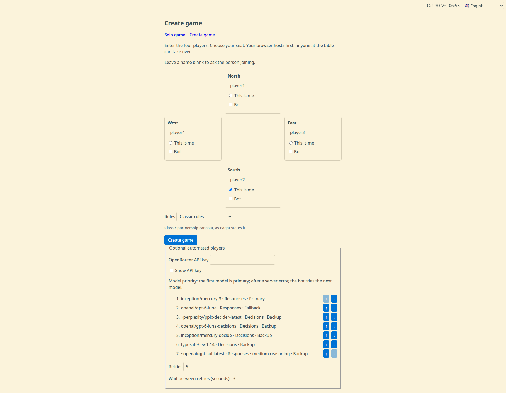
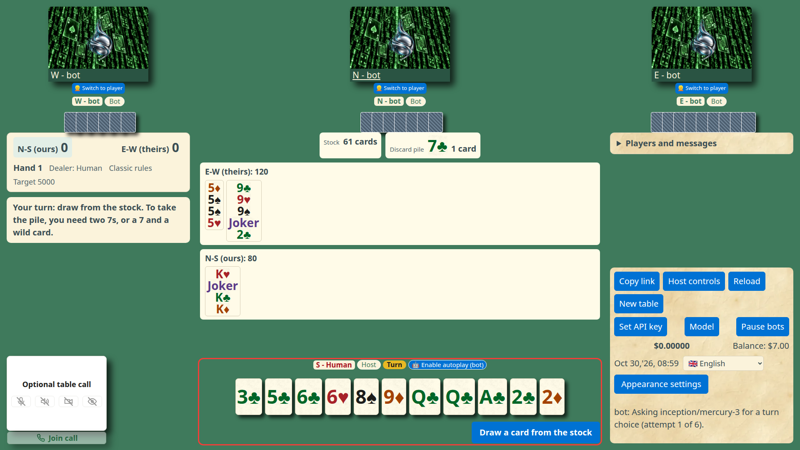

# Open Canasta

Open Canasta is a four-player partnership canasta game that runs in the browser.
It supports human players, optional voice and video calls, and AI players powered by OpenRouter.
The game deals the cards, offers only legal actions, and keeps the score of the match.

**Play:** [dvolgyes.github.io/open_canasta](https://dvolgyes.github.io/open_canasta/)

**Source:** [github.com/dvolgyes/open_canasta](https://github.com/dvolgyes/open_canasta)

The game is a static site with no game server or database.
Players find each other through public WebTorrent trackers and MQTT brokers, then exchange game data directly over WebRTC.
Site operators can set `VITE_TRACKER_URLS` at build time to a comma-separated list of secure WebSocket tracker URLs, or to `none` to disable tracker discovery.
One browser coordinates the table at a time; every seated browser stores a copy so another can take over if needed.
The table key is in the link fragment and is not sent to the web server.
By default, WebRTC uses STUN servers operated by Cloudflare and Google to discover network addresses.
These servers receive the browser's network address when contacted.
Site operators can set `VITE_STUN_URLS` at build time to a comma-separated list of STUN URLs, or to `none` to disable STUN.
Disabling STUN can prevent connections across some networks.
The default MQTT brokers are operated by EMQX, HiveMQ, and Coreflux and receive the browser's network address.
Site operators can set `VITE_MQTT_BROKER_URLS` at build time to a comma-separated list of secure WebSocket broker URLs, or to `none` to disable MQTT discovery.
The site publishes these `VITE_` settings in its JavaScript, so do not put credentials or API keys in them.

## How to play

Open Canasta is a classic four-player partnership canasta table.
North and South form one side, and East and West form the other.
The game uses two decks with four jokers, 108 cards in total.
The first side to reach 5000 points wins the match.

### Create a table and invite friends

1. Open Open Canasta and enter your name.
   You can leave another seat's name blank so that its player enters a name when joining.
2. Select **This is me** beside the seat you want to play.
3. Optionally, choose the rule variant under **Rules** (see [Rule variants](#rule-variants)).
   The table uses the classic rules when you change nothing.
4. Select **Create game**.
   Your browser creates the table, takes your seat, and copies the table link when clipboard access is available.
5. Use **Copy link** on a desktop or **Share URL** on a touch device to share the full link with your friends in a private message.
6. Each friend opens the link and selects one of the available seats.
   If only one seat remains, Open Canasta takes it automatically.



The table link is the invitation key.
The trackers can announce that a table exists, but a person still needs the complete link to join, because the table key is carried in the link fragment.
Treat the full link like a password: send it only to people you want at the table.
Do not post it publicly.

### Take a seat and play

The table opens at a seat-selection screen when more than one seat is free.
Choose the seat the host agreed with you.
If a seat is already held by an active browser, choose another available seat or ask its player to release it.
A personal link that names your seat can reopen it when the seat is free.
A shared link asks before it reopens a seat remembered by the browser.

When all four seats are ready, the table deals the first hand automatically: eleven cards to each player.
After the first deal, play can continue while another seat is away until that seat needs to act.
The first dealer is chosen at random, the deal then passes to the left, and the player at the dealer's left starts.
In each turn, a player does these steps:

1. Draw the top card of the stock, or take the whole discard pile.
2. Optionally meld: lay down sets of three or more cards of the same rank, or add cards to the side's melds.
3. Discard one card, unless the player goes out.

The table offers only legal actions.
Your hand is always sorted by rank: 3 to A, then 2s, then jokers.
Select cards in your hand to see the melds, extensions, and discards that use them.
In your turn, frames on the cards of your hand help you:

- Right after you draw or take the pile, a gold frame and a star mark the new cards.
- After that, a red frame and a plus mark the natural cards that fit a meld of your side, and the cards that can make a new meld.
- Point at a framed card to see why it has the frame.

Above its melds, each side shows its points on the table in this hand: its melds, then in brackets its canasta bonuses and its red 3s (♥), for example `E-W (ours): 110 (+300 canasta, +200 ♥)`.
Point at the line to see each part.
A phone shows only the sum, then a ♥ for each red 3 of the side, for example `E-W (ours): 610 ♥♥`.
On a narrow phone, the title's font becomes smaller so that the title stays on one line beside the red 3s.
When even the smallest font does not fit, the title ends with "…".
Cards in hand and the going-out bonus count only when the hand ends.



The main rules, in short:

- Jokers and 2s are wild cards.
  A meld needs at least two natural cards, and it can hold at most three wild cards.
- A canasta is a meld of seven or more cards.
  A natural canasta (no wild cards) scores 500, and a mixed canasta scores 300.
  A side must have at least one canasta before one of its players can go out.
- A side's first meld in a hand must reach a minimum count, which depends on the side's score: 50 points from 0, 90 from 1500, and 120 from 3000.
  A side with a negative score needs only 15.
  When a player takes the pile for the first meld, the top card counts toward the minimum, but the rest of the pile does not.
  Until the minimum is reached, a gold frame marks the cards from the pile in the hand.
- A red 3 is set aside at once, and the player draws a replacement.
  Each red 3 scores 100 for its side, or subtracts 100 if the side has not melded in that hand.
  All four red 3s on one side score 800.
- A black 3 discard blocks the next player from taking the pile.
  Black 3s can be melded only by a player who goes out in that turn: three or four of them, with no wild card.
- To take the pile, a player melds its top card: with two matching cards from the hand, with one matching card and a wild card, or on a meld of the side.
- A pile with a wild card in it is frozen for both sides until a player takes it.
  A red 3 or a wild card turned up as the first pile card at the deal also freezes it.
  The label under the pile says why it is frozen, because the card that freezes it can be under the top card.
  As on a real table, that card lies crosswise beside the top card, or the top card turns when it is that card.
  The pile is also frozen for a side that has not melded yet.
  A frozen pile can be taken only with two natural cards from the hand that match its top card.
- The hand ends when a player goes out, or when the stock runs out and the next player does not take the pile.
  At an empty stock, a player must take an unfrozen pile whose top card goes onto a meld of the side.
  Going out scores 100, or 200 when the player goes out in one turn without an earlier meld.
  Cards still in a hand count against their side.

After a hand ends, a summary on the table explains how the hand ended and shows the score of the hand, item by item, with the match score.
After 10 seconds, the host deals the next hand.
The exact rules and the points that differ between published variants are in [ADR 0007](docs/adr/0007-canasta-engine-written-here.md).

### Rule variants

The table creator chooses one rule variant for the whole match.
The score strip at the table shows its name.
Each variant changes only the points below; all other rules stay classic.
They follow the variants that [Pagat](https://www.pagat.com/rummy/canasta.html) describes.

- **Classic rules** (the default): the rules above.
- **Frozen pile**: the pile is always frozen.
  A player takes it only with a natural pair of its top card's rank from the hand.
- **Draw two**: a player draws two cards from the stock and still discards one.
- **Two canastas to go out**: a side needs two canastas before one of its players can go out.
- **Viennese rules**:
  - A meld cannot hold more wild cards than natural cards.
  - A side cannot take the pile while its top card is of a rank in which the side has a canasta.
  - Red 3s count positive only for a side with a canasta.
  - Going out concealed with a canasta of one's own scores 1000 in total, and on the side's earlier canasta 200.
    A pile pickup in that turn loses this bonus.

The bots receive the rules of the table with every turn.

You must take one of the four player seats to use the table.
There is no spectator or kibitz mode, so people who are not seated cannot watch the game.

### Reset the match

**Reset** clears the scores and starts a new match with the same players.
The host finds **Reset** in **Host controls**; other players can request it from their table controls.
Every other player at the table must approve the reset; one rejection cancels it.
The player who asked can cancel the request.
The game waits while a reset request is open.
The chat and the call stay as they are.
After a side wins the match, use **Reset** to play again.

### Use bots

Bots can fill seats for a game, or the host can turn on autoplay for a player who needs to step away temporarily.
Choose **Solo game** to start as South with three host-managed bots.
For a permanent bot seat, select **Bot** for that seat while creating the table.
A player can request autoplay for their own seat and stop it later.
The player stays in the table call while their requested autoplay is active.
The host can also assign a seat to a bot and return it to a player; assigning a bot ends that seat's call.
On an upright phone, the host finds the other players' bot switches in **Host controls**.
Bots approve a reset request automatically.

OpenRouter is a service that provides access to AI models from many providers through one API.
Bot play can cost money because AI model requests may be billed; the table displays the accumulated OpenRouter cost as you play.
When OpenRouter returns account credit information, the host also sees the available balance, capped by any key spending limit.
If only a key limit is available, the table labels it separately; it is not the account balance.
You bring your own [OpenRouter API key](https://openrouter.ai/).
Enter the key in the create screen, or in the table's bot controls before enabling a substitute.
Before a new key is stored, the browser checks it with OpenRouter's current-key endpoint without sending a model request.
This check does not establish whether the selected model is available or the account has enough credit.
If OpenRouter rejects the key (HTTP 401), the key is not stored.
If the test fails for another reason, the key is stored, the problem is shown, and you select the button again to continue.
The create screen keeps the key also when no seat is a bot, so autoplay can use it later.
To remove the stored key, clear the field and create a table, or clear it in the table's key dialog.
An empty key is not tested; at the table, the running bots pause until a key is set.
The key is stored in the host browser and is not included in the shared table link.
If the current host has no usable key, bot play is unavailable until a host with a key takes over or the key is set.
You can choose the model order and retry settings when creating the table.
A bot chooses from a numbered list of the legal actions.
If the model gives no usable answer, the bot uses a simple built-in heuristic for that turn.

### Call and finding players

The table includes an optional audio and video call for the players at the table.
Each player chooses whether to join the call and whether to send a microphone or camera.
The host can invite other players to join, but the invitation does not start their microphone or camera.
On a phone, a player can send a confirmed camera but cannot receive video, and the table shows names instead of video tiles.
On a desktop, **Mirror** shows or hides the player's own camera preview without changing what other players receive.
The felt is at the top of the phone screen, and the turn status, the scores, the call and the table controls are below it.
To save space on a phone, the felt uses the full screen width, and the cards of your hand are smaller with text of the same size.
The cards of your hand stay in one row: when they do not fit, they come closer together or overlap.
When they overlap, each card lies on the card to its left, so that the rank and suit at the left edge of every card stay visible.
The partner's name and cards share one row.
The stock is to the left of the opponents' melds and the discard pile is to the right, each with its label above its cards.
The left and right players stand narrow beside your side's melds, with their cards in a column.
Each side's melds stay in one row, and they become smaller when they do not fit.
The call is separate from canasta actions, so using autoplay does not make the player leave the call.
The call has no kibitz or spectator access.

### Network and appearance

The **Network** panel shows connection progress and lets a player enable more frequent connection checks.
It lists each configured tracker and MQTT broker by host, with its socket state and when the browser last heard from it.
The optional checks can close and repair a silent peer link while the page is visible and online.
A false timeout can temporarily split the table, and actions on a losing branch can be lost when the table rejoins.
The host can view connection quality and copy a diagnostic report from **Host controls**.
The report excludes table keys, API keys, addresses, player names, cards and messages.
**Appearance settings** controls the theme, textures, card text, turn indicators and other display choices.
Use **Reload** to reload the current table after queued writes finish.

Open Canasta does not currently provide matchmaking or a way to find random players online.
You need to invite people yourself and share the table link with them.

### Save and reuse a table link

You can bookmark or save the shared table link and reuse it with regular partners.
The link keeps the seat names and table setup, so it can start a fresh table for the same group without creating and distributing another invitation.
The current game state is stored in the players' browsers, not on a game server.
After about 24 hours without activity on a device, its saved table expires; starting again from the saved link creates a fresh session and does not restore the previous hand, score, or seat claims.
If the expired table is open and its link contains a complete setup, choose **Restart this game** to start again with that setup.
Use **Copy link** or **Share URL** in the table if you need to share the invitation again.

### Fair play

Every seated browser stores the whole table state, including the other hands and the stock, so that any player can take over as the host.
The screen hides the cards that a player must not see, but a player who inspects the browser's storage or network traffic can see them.
The game is meant for friends who trust each other.
[ADR 0008](docs/adr/0008-module-boundaries.md) records this decision.

## Development

The game is TypeScript, built with Vite.
See [CLAUDE.md](CLAUDE.md) for the module map and the commands for tests and checks.

```sh
npm install
npm run dev        # local development server
npm run build      # type check and production build into dist/
npm test           # unit tests and browser tests
npx playwright test  # end-to-end tests with several browsers
npm run test:e2e:live  # live OpenRouter CLI bot test
```

For a command-line bot, set `OPENROUTER_API_KEY` in the local `.env` file and run `npm run bot -- '<table-url>' --user '<seat-name>'`.
The live test reads the same key, contacts OpenRouter and can incur model charges.
The user name must match a seat name in the table link.
The key remains local and is not added to the link.

## License

Open Canasta is all rights reserved.
The source code and original assets are not licensed for reuse or independent hosting.
Third-party components keep their own licenses.
The distributed [third-party notices](public/licenses/NOTICE.md) identify the adapted Trystero signaling code and MQTT.js.
See [LICENSE](LICENSE) for the terms.
GitHub's terms still allow users to view and fork a public repository ([GitHub licensing documentation](https://docs.github.com/en/repositories/managing-your-repositorys-settings-and-features/customizing-your-repository/licensing-a-repository)).
